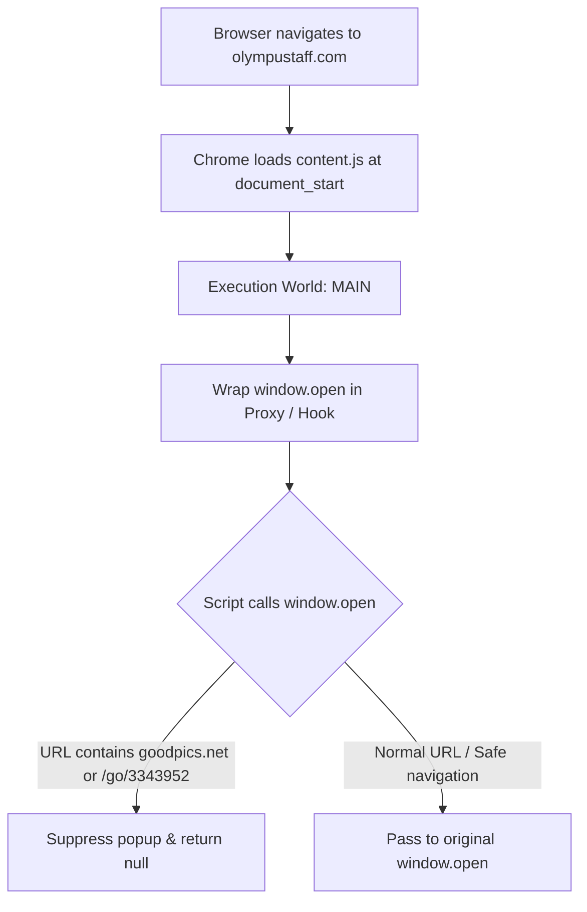

<div align="center">

<a href="https://github.com/shadow-x78/teamx-adblock">
  
</a>

# TeamX - AdBlock

Precision ad popup blocker engineered exclusively for Olympus Staff (`olympustaff.com`).

[](CHANGELOG.md)
[](LICENSE)


[](docs/AUTO_UPDATE.md)

</div>

---

## Language

<a href="README.md">🇬🇧 English</a> · <a href="README_AR.md">🇸🇦 العربية</a>

---

## Table of Contents

- [Overview](#overview)
- [Comparison](#comparison)
- [Target Scope](#target-scope)
- [Features](#features)
- [Installation](#installation)
- [Automatic Background Updates](#automatic-background-updates)
- [Architecture](#architecture)
- [Project Structure](#project-structure)
- [Documentation](#documentation)
- [Contributing](#contributing)
- [License](#license)

---

<a id="overview"></a>
## Overview

**TeamX - AdBlock** is an ultra-fast, zero-overhead browser extension (Manifest V3) purpose-built to stop aggressive, unwanted popups and redirect ads on `olympustaff.com`.

Unlike generic ad blockers that inject heavy DOM filter lists and slow down page rendering, **TeamX - AdBlock** hooks directly into the page's original execution environment (`world: "MAIN"`) at `document_start` to intercept malicious `window.open` trigger invocations natively before they can spawn annoying tabs or popups.

---

<a id="comparison"></a>
## Comparison

| Capability | Generic Ad-blockers | Script Managers | **TeamX - AdBlock** |
| :--- | :---: | :---: | :---: |
| Execution context | ⚠️ Isolated world | ⚠️ Late userscript | ✅ **MAIN World** (`document_start`) |
| Intercept inline scripts | ❌ Misses fast triggers | ⚠️ Timing dependent | ✅ **100% Guaranteed hook** |
| Memory overhead | ~100-250 MB | ~30-60 MB | ✅ **< 1 MB (Zero overhead)** |
| Site responsiveness | Slows reader/DOM | Moderate impact | ✅ **Native instantaneous speed** |
| Scoped strictly to site | ❌ Global rules | ⚠️ User-configured | ✅ **Domain-exclusive** |
| Automatic background updates | ⚠️ Extension store | ⚠️ Manual scripts | ✅ **Native Omaha protocol** |

---

<a id="target-scope"></a>
## Target Scope

The extension strictly activates on:
- `https://olympustaff.com/*`
- `https://*.olympustaff.com/*`

It monitors window creation calls and completely terminates any requests containing:
- `goodpics.net`
- `/go/3343952`

All other legitimate browser popups, reader tools, and navigation links execute with zero interference.

---

<a id="features"></a>
## Features

- ⚡ **Instant Execution:** Injected at `document_start` before page scripts initialize.
- 🛡️ **Native Interception:** Executes in the page's `MAIN` execution context to bypass inline evasion tricks.
- 🔄 **Fully Automated Updates:** Built-in Omaha protocol support enables automatic silent background updates directly from GitHub.
- 🎨 **Authentic Brand Iconography:** Custom vector-crafted brand shield designed around the official Olympus Staff TeamX identity.
- 🪶 **Zero Dependencies:** Pure, clean, lightweight vanilla JavaScript.

---

<a id="installation"></a>
## Installation

### Option 1: Pre-packaged `.crx` (Recommended)

1. Download the latest [`TeamX-AdBlock.crx`](https://github.com/shadow-x78/teamx-adblock/releases/latest/download/TeamX-AdBlock.crx) from Releases.
2. Open `chrome://extensions/` in your browser.
3. Toggle **Developer mode** in the top-right corner.
4. Drag and drop the `.crx` file onto the extensions page.
5. Confirm installation.

> [!TIP]
> Extensions installed via `.crx` receive **automatic background updates** directly from this repository without requiring any manual action!

### Option 2: Load Unpacked Source (For Developers)

```bash
git clone https://github.com/shadow-x78/teamx-adblock.git
```

1. Open `chrome://extensions/`.
2. Enable **Developer mode**.
3. Click **Load unpacked** and select the cloned directory.

---

<a id="automatic-background-updates"></a>
## Automatic Background Updates

This extension integrates Google's official **Autoupdate Protocol**:

- **Manifest Declaration:** Points to the repository's [`updates.xml`](updates.xml).
- **Silent Background Checks:** Your browser periodically polls GitHub raw content in the background.
- **Zero-Touch Upgrades:** When a new version is released, Chrome pulls the signed `.crx`, verifies cryptographic signatures, and seamlessly updates the extension with zero user interaction needed.

For architectural and release details, read the [Auto-Update Documentation](docs/AUTO_UPDATE.md).

---

<a id="architecture"></a>
## Architecture



Read full technical breakdown in [ARCHITECTURE.md](docs/ARCHITECTURE.md).

---

<a id="project-structure"></a>
## Project Structure

```text
teamx-adblock/
├── .github/
│   └── workflows/
│       └── release.yml          # Automated CI/CD release & CRX builder
├── assets/
│   └── logo/
│       ├── teamx-adblock-banner.png     # English banner asset
│       ├── teamx-adblock-banner-ar.png  # Arabic banner asset
│       └── teamx-adblock-logo.png       # Master brand logo
├── docs/
│   ├── ARCHITECTURE.md          # Technical design & hook lifecycle
│   ├── ARCHITECTURE_AR.md       # Arabic technical design
│   ├── AUTO_UPDATE.md           # Omaha protocol & auto-update pipeline
│   ├── AUTO_UPDATE_AR.md        # Arabic auto-update guide
│   ├── INSTALLATION.md          # Step-by-step installation instructions
│   └── INSTALLATION_AR.md       # Arabic installation instructions
├── icons/
│   ├── icon16.png               # Browser toolbar & favicon size
│   ├── icon32.png               # Retina resolution display
│   ├── icon48.png               # Extension manager view
│   ├── icon128.png              # High-res store & install display
│   └── icon512.png              # Master high-resolution asset
├── content.js                   # Interception logic (MAIN execution world)
├── manifest.json                # Manifest V3 extension configuration
├── updates.xml                  # Chrome Autoupdate protocol manifest
├── CHANGELOG.md                 # Semantic versioning release log
├── CODE_OF_CONDUCT.md           # Contributor Covenant code of conduct
├── CONTRIBUTING.md              # Guidelines for contributors
├── LICENSE                      # MIT License
├── README.md                    # English documentation
├── README_AR.md                 # Arabic documentation
└── SECURITY.md                  # Security and vulnerability reporting
```

---

<a id="documentation"></a>
## Documentation

| Document | Description |
| :--- | :--- |
| [ARCHITECTURE.md](docs/ARCHITECTURE.md) ([العربية](docs/ARCHITECTURE_AR.md)) | Technical execution flow, MAIN world mechanics, and popup interception |
| [AUTO_UPDATE.md](docs/AUTO_UPDATE.md) ([العربية](docs/AUTO_UPDATE_AR.md)) | Google Omaha autoupdate protocol, cryptographic signing, and release workflow |
| [INSTALLATION.md](docs/INSTALLATION.md) ([العربية](docs/INSTALLATION_AR.md)) | Multi-browser installation steps and verification procedures |

---

<a id="contributing"></a>
## Contributing

1. Fork the repository and create your branch (`feature/xyz`, `fix/xyz`).
2. Maintain strict zero-dependency vanilla JavaScript standards.
3. Commit as `teamx-adblock | <type>: <description>` (e.g. `teamx-adblock | feat: add rule`).
4. Test compatibility directly against `olympustaff.com`.
5. Submit a Pull Request.

Please review our [Contributing Guidelines](CONTRIBUTING.md) and [Code of Conduct](CODE_OF_CONDUCT.md).

---

<a id="license"></a>
## License

Distributed under the [MIT License](LICENSE).

---

<div align="center">

Built by <a href="https://github.com/shadow-x78">shadow-x78</a> ·
[Changelog](CHANGELOG.md) ·
[Security](SECURITY.md)

<sub>&copy; 2026 TeamX - AdBlock</sub>

</div>
