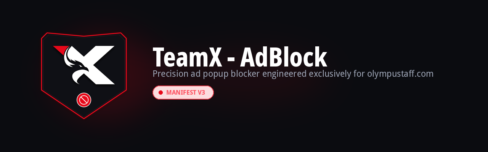
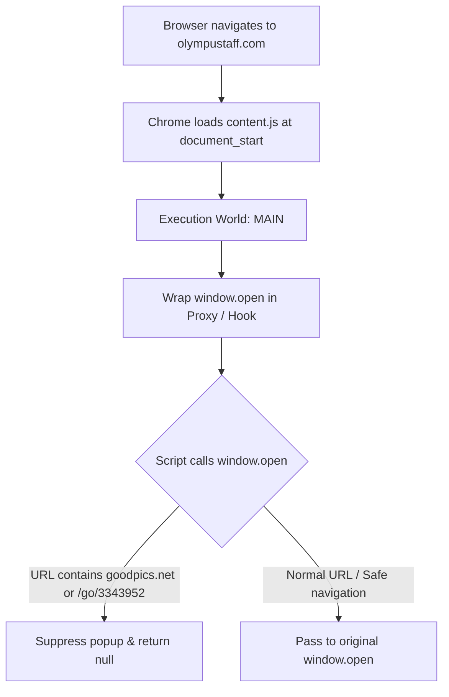

<div align="center">

<a href="https://github.com/shadow-x78/teamx-adblock">
  
</a>

# TeamX - AdBlock

Precision ad popup blocker engineered exclusively for Olympus Staff (`olympustaff.com`).

[](CHANGELOG.md)
[](LICENSE)

[](https://github.com/shadow-x78/teamx-adblock)
[](docs/AUTO_UPDATE.md)

</div>

---

## Language

<a href="README.md">🇬🇧 English</a> · <a href="README_AR.md">🇸🇦 العربية</a>

---

## Table of Contents

- [Overview](#overview)
- [Comparison](#comparison)
- [Target Scope](#target-scope)
- [Features](#features)
- [Video Tutorial](#video-tutorial)
- [Installation](#installation)
- [Automatic Background Updates](#automatic-background-updates)
- [Architecture](#architecture)
- [Project Structure](#project-structure)
- [Documentation](#documentation)
- [Contributing](#contributing)
- [License](#license)

---

<a id="overview"></a>
## Overview

**TeamX - AdBlock** is an ultra-fast, zero-overhead browser extension (Manifest V3) purpose-built to eliminate all advertisements, banners, popunders, and redirect popups on `olympustaff.com`.

Unlike generic ad blockers that inject heavy DOM filter lists and trigger anti-adblock detection, **TeamX - AdBlock** combines declarative network-level request blocking, surgical DOM cosmetic elimination, and deep engine-level hooks in the page's original execution environment (`world: "MAIN"`) at `document_start`. It neutralizes ad runners like `aclib`, removes sticky `#fixedban` banners, blocks popunder scripts, and bypasses anti-adblock detection scripts with zero layout shifts.

---

<a id="comparison"></a>
## Comparison

| Capability | Generic Ad-blockers | Script Managers | **TeamX - AdBlock** |
| :--- | :---: | :---: | :---: |
| Execution context | ⚠️ Isolated world | ⚠️ Late userscript | ✅ **MAIN World** (`document_start`) |
| Intercept inline scripts & banners | ❌ Misses fast triggers | ⚠️ Timing dependent | ✅ **100% Guaranteed hook & proxy** |
| Anti-adblock evasion | ❌ Triggers warning modal | ⚠️ Breaks reader DOM | ✅ **Silent automated probe bypass** |
| Memory overhead | ~100-250 MB | ~30-60 MB | ✅ **< 1 MB (Zero overhead)** |
| Site responsiveness | Slows reader/DOM | Moderate impact | ✅ **Native instantaneous speed** |
| Browser support | Varies | Varies | ✅ **Chrome & Firefox Universal** |
| Scoped strictly to site | ❌ Global rules | ⚠️ User-configured | ✅ **Domain-exclusive** |
| Automatic background updates | ⚠️ Extension store | ⚠️ Manual scripts | ✅ **Native Omaha protocol** |

---

<a id="target-scope"></a>
## Target Scope

The extension strictly activates on:
- `https://olympustaff.com/*`
- `https://*.olympustaff.com/*`

It actively terminates and neutralizes:
- **Popups & Redirects:** Intercepts `window.open` calls and click-hijacking listeners (`goodpics.net`, `/go/3343952`, ad campaigns).
- **Popunder Networks:** Disables Monetag / PropellerAds (`au.teethesmitsvah.com`, `blockadsnot.com`, `cnejpkmvsjvft.com`, `odpktokz.com`).
- **In-Page Banners:** Pre-emptively stubs `window.aclib` (`runBanner`, `runPop`, `runPush`), preventing ad scripts from spawning iframe slots.
- **Sticky Overlays:** Strips floating `#fixedban` containers and chapter banners (`.body-top-ads`, `.body-bottom-ads`, `.c-ads`).
- **Anti-AdBlock Detection:** Defuses BlockAdBlock probes and inline eval modal triggers seamlessly.

---

<a id="features"></a>
## Features

- ⚡ **Instant Execution:** Injected at `document_start` before page scripts initialize.
- 🛡️ **Multi-Layered Protection:** Combines Declarative Net Request rules (`rules.json`), cosmetic CSS (`rules.css`), and JavaScript hooks (`content.js`).
- 🛑 **Complete Ad Annihilation:** Zero in-page banners, zero floating bars, zero popunders, and zero click popups.
- 🦊 **Universal Compatibility:** Full native support for Chromium (Chrome, Brave, Edge, Kiwi Browser) and Gecko (Mozilla Firefox 109+).
- 🔄 **Fully Automated Updates:** Built-in Omaha protocol support enables automatic silent background updates directly from GitHub.
- 🎨 **Authentic Brand Iconography:** Custom vector-crafted brand shield designed around the official Olympus Staff TeamX identity.
- 🪶 **Zero Dependencies:** Pure, clean, lightweight vanilla JavaScript without third-party libraries.

---

<a id="video-tutorial"></a>
## Video Tutorial

Step-by-step walkthrough demonstrating installation on **PC** (Google Chrome / Chromium) and **Mobile** (Kiwi Browser for Android):

<video src="https://github.com/user-attachments/assets/275fd7df-f6fc-42b6-a293-3d121013b46d" poster="assets/videos/TeamX_AdBlock_Tutorial_EN_poster.jpg" controls width="100%" style="max-width: 100%;">
  <p>Your browser does not support embedded HTML5 video. You can <a href="https://raw.githubusercontent.com/shadow-x78/teamx-adblock/main/assets/videos/TeamX_AdBlock_Tutorial_EN.mp4">view or download the video directly</a>.</p>
</video>

▶ **Watch the English walkthrough** — 1920×1080 · H.264/AAC · 00:52 · [Download MP4](https://raw.githubusercontent.com/shadow-x78/teamx-adblock/main/assets/videos/TeamX_AdBlock_Tutorial_EN.mp4) · [🇸🇦 النسخة العربية](README_AR.md#فيديو-الشرح-والتثبيت)

> [!NOTE]
> The inline player is served from GitHub's asset store, while the same recording stays versioned inside `assets/videos/` in this repository.

---

<a id="installation"></a>
## Installation

### For Google Chrome, Brave, and Edge
1. Download [`TeamX-AdBlock.crx`](https://github.com/shadow-x78/teamx-adblock/releases/latest/download/TeamX-AdBlock.crx) from Releases.
2. Open `chrome://extensions/` and enable **Developer mode**.
3. Drag and drop the `.crx` file onto the page to install.

### For Android (Kiwi Browser)
1. Install **Kiwi Browser** from the [Google Play Store](https://play.google.com/store/apps/details?id=com.kiwibrowser.browser).
2. Download [`TeamX-AdBlock.crx`](https://github.com/shadow-x78/teamx-adblock/releases/latest/download/TeamX-AdBlock.crx).
3. Open `kiwi://extensions` in the address bar.
4. Enable **Developer mode** toggle in the top-right.
5. Tap **+(from .zip/.crx/.user.js)**, select the downloaded `.crx` file, and confirm.

### For Mozilla Firefox
1. Download [`TeamX-AdBlock.xpi`](https://github.com/shadow-x78/teamx-adblock/releases/latest/download/TeamX-AdBlock.xpi) from Releases.
2. Navigate to `about:debugging#/runtime/this-firefox`.
3. Click **Load Temporary Add-on...** and select the `.xpi` file (or `manifest.json`).

Read detailed steps in the [Installation Guide](docs/INSTALLATION.md).

---

<a id="automatic-background-updates"></a>
## Automatic Background Updates

This extension integrates Google's official **Autoupdate Protocol**:

- **Manifest Declaration:** Points to the repository's [`updates.xml`](updates.xml).
- **Silent Background Checks:** Your browser periodically polls GitHub raw content in the background.
- **Zero-Touch Upgrades:** When a new version is released, Chrome pulls the signed `.crx`, verifies cryptographic signatures, and seamlessly updates the extension with zero user interaction needed.

For architectural and release details, read the [Auto-Update Documentation](docs/AUTO_UPDATE.md).

---

<a id="architecture"></a>
## Architecture



Read full technical breakdown in [ARCHITECTURE.md](docs/ARCHITECTURE.md).

---

<a id="project-structure"></a>
## Project Structure

```text
teamx-adblock/
├── .github/
│   └── workflows/
│       └── release.yml          # Automated CI/CD release & CRX builder
├── assets/
│   ├── logo/
│   │   ├── teamx-adblock-banner.png     # English banner asset
│   │   ├── teamx-adblock-banner-ar.png  # Arabic banner asset
│   │   └── teamx-adblock-logo.png       # Master brand logo
│   └── videos/
│       ├── TeamX_AdBlock_Tutorial_AR.mp4        # Arabic tutorial video
│       ├── TeamX_AdBlock_Tutorial_AR_poster.jpg # Arabic tutorial poster frame
│       ├── TeamX_AdBlock_Tutorial_EN.mp4        # English tutorial video
│       └── TeamX_AdBlock_Tutorial_EN_poster.jpg # English tutorial poster frame
├── docs/
│   ├── ARCHITECTURE.md          # Technical design & hook lifecycle
│   ├── ARCHITECTURE_AR.md       # Arabic technical design
│   ├── AUTO_UPDATE.md           # Omaha protocol & auto-update pipeline
│   ├── AUTO_UPDATE_AR.md        # Arabic auto-update guide
│   ├── INSTALLATION.md          # Step-by-step installation instructions
│   └── INSTALLATION_AR.md       # Arabic installation instructions
├── icons/
│   ├── icon16.png               # Browser toolbar & favicon size
│   ├── icon32.png               # Retina resolution display
│   ├── icon48.png               # Extension manager view
│   ├── icon128.png              # High-res store & install display
│   └── icon512.png              # Master high-resolution asset
├── content.js                   # Interception logic (MAIN execution world)
├── rules.css                    # Cosmetic ad hiding & layout collapse
├── rules.json                   # Declarative Net Request blocking rules
├── manifest.json                # Manifest V3 extension configuration
├── updates.xml                  # Chrome Autoupdate protocol manifest
├── CHANGELOG.md                 # Semantic versioning release log
├── CODE_OF_CONDUCT.md           # Contributor Covenant code of conduct
├── CONTRIBUTING.md              # Guidelines for contributors
├── LICENSE                      # MIT License
├── README.md                    # English documentation
├── README_AR.md                 # Arabic documentation
└── SECURITY.md                  # Security and vulnerability reporting
```

---

<a id="documentation"></a>
## Documentation

| Document | Description |
| :--- | :--- |
| [ARCHITECTURE.md](docs/ARCHITECTURE.md) ([العربية](docs/ARCHITECTURE_AR.md)) | Technical execution flow, MAIN world mechanics, and popup interception |
| [AUTO_UPDATE.md](docs/AUTO_UPDATE.md) ([العربية](docs/AUTO_UPDATE_AR.md)) | Google Omaha autoupdate protocol, cryptographic signing, and release workflow |
| [INSTALLATION.md](docs/INSTALLATION.md) ([العربية](docs/INSTALLATION_AR.md)) | Multi-browser installation steps and verification procedures |

---

<a id="contributing"></a>
## Contributing

1. Fork the repository and create your branch (`feature/xyz`, `fix/xyz`).
2. Maintain strict zero-dependency vanilla JavaScript standards.
3. Commit as `teamx-adblock | <type>: <description>` (e.g. `teamx-adblock | feat: add rule`).
4. Test compatibility directly against `olympustaff.com`.
5. Submit a Pull Request.

Please review our [Contributing Guidelines](CONTRIBUTING.md) and [Code of Conduct](CODE_OF_CONDUCT.md).

---

<a id="license"></a>
## License

Distributed under the [MIT License](LICENSE).

---

<div align="center">

Built by <a href="https://github.com/shadow-x78">shadow-x78</a> ·
[Changelog](CHANGELOG.md) ·
[Security](SECURITY.md)

<sub>&copy; 2026 TeamX - AdBlock</sub>

</div>
