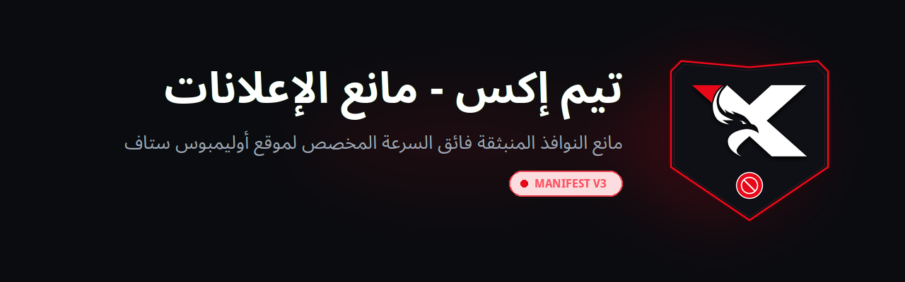
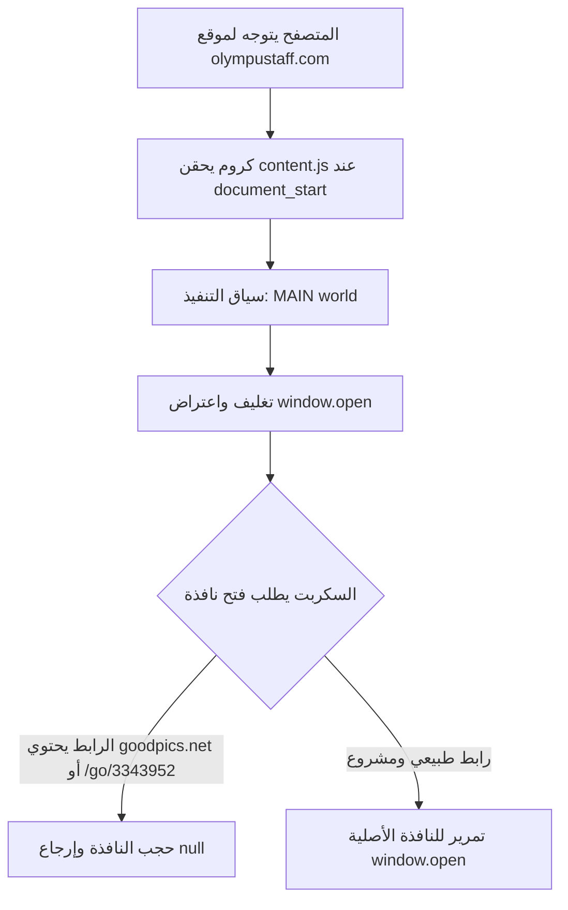

<div align="center">

<a href="https://github.com/shadow-x78/teamx-adblock">
  
</a>

# TeamX - AdBlock

مانع النوافذ المنبثقة فائق السرعة المخصص لموقع أوليمبوس ستاف (`olympustaff.com`).

[](CHANGELOG.md)
[](LICENSE)

[](https://github.com/shadow-x78/teamx-adblock)
[](docs/AUTO_UPDATE.md)

</div>

---

## اللغة

<a href="README.md">🇬🇧 English</a> · <a href="README_AR.md">🇸🇦 العربية</a>

---

## جدول المحتويات

- [نظرة عامة](#نظرة-عامة)
- [المقارنة](#المقارنة)
- [نطاق العمل](#نطاق-العمل)
- [المميزات](#المميزات)
- [فيديو الشرح والتثبيت](#فيديو-الشرح-والتثبيت)
- [طريقة التثبيت](#طريقة-التثبيت)
- [التحديث التلقائي في الخلفية](#التحديث-التلقائي-في-الخلفية)
- [البنية البرمجية](#البنية-البرمجية)
- [هيكلية المشروع](#هيكلية-المشروع)
- [التوثيق التقني](#التوثيق-التقني)
- [المساهمة](#المساهمة)
- [الترخيص](#الترخيص)

---

<a id="نظرة-عامة"></a>
## نظرة عامة

**TeamX - AdBlock** هي إضافة متصفح فائقة السرعة ومبنية بمعمارية Manifest V3 صُممت خصيصاً للقضاء التام والنهائي على كافة أشكال الإعلانات، البانرات، النوافذ المنبثقة، وإعادة التوجيه الإجباري على موقع `olympustaff.com`.

على عكس برامج الحجب العامة التي تبطئ التصفح بقوائم ضخمة وتتسبب في إطلاق تحذيرات حظر مانع الإعلانات، تدمج هذه الإضافة بين قواعد الحظر على مستوى الشبكة (`declarativeNetRequest`)، وحجب العناصر التجميلي (`rules.css`)، والتعطيل المسبق للأكواد البرمجية (`content.js`) في السياق الأصلي للصفحة (`world: "MAIN"`) عند `document_start`. تعمل الإضافة على شل حركة محركات الإعلانات مثل `aclib` وإزالة شريط `#fixedban` العائم وتخطي سكربتات كشف مانع الإعلانات دون أي وميض أو تأخير.

---

<a id="المقارنة"></a>
## المقارنة

| الخاصية | برامج الحجب العامة | سكربتات المستخدمين | **TeamX - AdBlock** |
| :--- | :---: | :---: | :---: |
| سياق التنفيذ | ⚠️ Isolated world | ⚠️ Userscript متأخر | ✅ **MAIN World** (`document_start`) |
| شل حركة محركات البانرات والأكواد المضمنة | ❌ تفلت السكربتات السريعة | ⚠️ يعتمد على التوقيت | ✅ **بروكسي مسبق واعتراض مضمون 100%** |
| تجاوز كاشف مانع الإعلانات | ❌ تظهر نافذة الحظر | ⚠️ تعطل قارئ الفصول | ✅ **تخطي صامت وتلقائي لجميع الفحوصات** |
| استهلاك الذاكرة | ~100-250 ميجابايت | ~30-60 ميجابايت | ✅ **أقل من 1 ميجابايت (معدوم)** |
| سرعة واستجابة التصفح | تباطؤ ملحوظ في القارئ | تأثير متوسط | ✅ **سرعة أصلية فورية بدون أي تأخير** |
| دعم المتصفحات | متفاوت | يتطلب إضافات إضافية | ✅ **كروم وفايرفوكس وKiwi بشكل شامل** |
| خصوصية النطاق | ❌ فلاتر عامة لكل المواقع | ⚠️ يتطلب إعداد يدوي | ✅ **موجّه ومحصور بالموقع فقط** |
| التحديث التلقائي الصامت | ⚠️ متجر الإضافات | ⚠️ تحديثات يدوية | ✅ **بروتوكول Omaha الرسمي** |

---

<a id="نطاق-العمل"></a>
## نطاق العمل

تعمل الإضافة حصرياً على الروابط التالية:
- `https://olympustaff.com/*`
- `https://*.olympustaff.com/*`

وتقوم بحظر واستئصال كافة أنواع الإعلانات:
- **النوافذ المنبثقة وإعادة التوجيه:** اعتراض دوال `window.open` ومنع مستمعي النقر الخاطف (`goodpics.net`, `/go/3343952`, الروابط الترويجية).
- **شبكات الإعلانات المنبثقة بالخلفية (Popunders):** حجب شبكات Monetag و PropellerAds (`au.teethesmitsvah.com`, `blockadsnot.com`, `cnejpkmvsjvft.com`, `odpktokz.com`).
- **بانرات الفصول والصفحات:** شل حركة دالة `aclib.runBanner` مسبقاً ومنع إنشاء أي إطارات إعلانية (iFrames).
- **الشريط العائم السفلي:** إخفاء واستئصال عنصر `#fixedban` وبانرات الفصول (`.body-top-ads`, `.body-bottom-ads`, `.c-ads`).
- **تخطي كاشف مانع الإعلانات:** إبطال مفعول سكريبتات BlockAdBlock وفحوصات الصور الوهمية في `window.eval`.

---

<a id="المميزات"></a>
## المميزات

- ⚡ **تنفيذ فوري:** تبدأ فوراً عند `document_start` وقبل اكتمال تحميل عناصر الصفحة.
- 🛡️ **حماية متعددة الطبقات:** تجمع بين قواعد الشبكة (`rules.json`) وتنسيقات CSS التجميلية (`rules.css`) واعتراض الجافاسكريبت (`content.js`).
- 🛑 **حظر كامل وشامل:** صفر إعلانات داخل الصفحات، صفر أشرطة عائمة، صفر نوافذ منبثقة، وصفر إعادة توجيه.
- 🦊 **دعم شامل للمتصفحات:** توافق كامل مع موزيلا فايرفوكس (Gecko 109+) ومتصفحات كروميوم (Chrome, Brave, Edge, Kiwi Browser).
- 🔄 **تحديثات تلقائية بدون تدخل المستخدم:** تدعم بروتوكول التحديث الرسمي لكروم (Omaha Protocol) لسحب التحديثات من GitHub وتثبيتها تلقائياً في الخلفية.
- 🎨 **هوية بصرية أصلية:** أيقونات وشعار فيكتور مستوحى مباشرة من درع TeamX الرسمي لموقع Olympus Staff.
- 🪶 **صفر اعتماديات:** كود جافاسكريبت نقي ونظيف بدون أي مكتبات خارجية.

---

<a id="فيديو-الشرح-والتثبيت"></a>
## فيديو الشرح والتثبيت

دليل مرئي عملي يوضح خطوات التثبيت بالتفصيل على **الكمبيوتر** (متصفح كروم / كروميوم) و**الهاتف** (عبر متصفح Kiwi الرسمي):

<video src="assets/videos/TeamX_AdBlock_Tutorial_AR.mp4" controls="controls" width="100%">
  <p>متصفحك لا يدعم تشغيل الفيديو المباشر. يمكنك <a href="assets/videos/TeamX_AdBlock_Tutorial_AR.mp4">مشاهدة أو تحميل الفيديو مباشرة</a>.</p>
</video>

---

<a id="طريقة-التثبيت"></a>
## طريقة التثبيت

### لمتصفحات كروم، بريف، وإيدج (الكمبيوتر)
1. حمّل ملف [`TeamX-AdBlock.crx`](https://github.com/shadow-x78/teamx-adblock/releases/latest/download/TeamX-AdBlock.crx) من صفحة الإصدارات.
2. افتح `chrome://extensions/` وفعّل **وضع المطور**.
3. اسحب ملف `.crx` وأفلته داخل الصفحة لتثبيته فوراً.

### للهواتف بنظام أندرويد (متصفح Kiwi)
1. ثبّت **متصفح Kiwi** من [متجر Google Play](https://play.google.com/store/apps/details?id=com.kiwibrowser.browser).
2. حمّل ملف [`TeamX-AdBlock.crx`](https://github.com/shadow-x78/teamx-adblock/releases/latest/download/TeamX-AdBlock.crx).
3. افتح الرابط `kiwi://extensions` في شريط العنوان.
4. فعّل زر **وضع المطور**.
5. اضغط على **+(from .zip/.crx/.user.js)** واختر ملف `.crx` الذي قمت بتحميله لتثبيته فوراً.

### لمتصفح موزيلا فايرفوكس
1. حمّل ملف [`TeamX-AdBlock.xpi`](https://github.com/shadow-x78/teamx-adblock/releases/latest/download/TeamX-AdBlock.xpi) from Releases.
2. افتح الرابط `about:debugging#/runtime/this-firefox`.
3. اضغط على **Load Temporary Add-on...** واختر ملف `.xpi` (أو `manifest.json`).

للاطلاع على الخطوات التفصيلية، راجع [دليل التثبيت الشامل](docs/INSTALLATION_AR.md).

---

<a id="التحديث-التلقائي-في-الخلفية"></a>
## التحديث التلقائي في الخلفية

تدعم هذه الإضافة بروتوكول التحديث التلقائي الرسمي من Google (Autoupdate Protocol):
- الإضافة تحتوي على رابط التحديث [`updates.xml`](updates.xml).
- يقوم متصفح كروم دورياً بفحص المستودع في الخلفية للتأكد من وجود إصدارات جديدة.
- عند نشر إصدار جديد، يتم سحب التحديث والتحقق من التوقيع الرقمي وتحديث الإضافة صامتاً دون أن يطلب المتصفح من المستخدم فعل أي شيء.

للاطلاع على التفاصيل البرمجية، راجع [دليل التحديث التلقائي](docs/AUTO_UPDATE_AR.md).

---

<a id="البنية-البرمجية"></a>
## البنية البرمجية



---

<a id="هيكلية-المشروع"></a>
## هيكلية المشروع

```text
teamx-adblock/
├── .github/
│   └── workflows/
│       └── release.yml          # سير عمل GitHub Actions لحزم وتجهيز الإصدارات
├── assets/
│   ├── logo/
│   │   ├── teamx-adblock-banner.png     # بانر التوثيق باللغة الإنجليزية
│   │   ├── teamx-adblock-banner-ar.png  # بانر التوثيق باللغة العربية
│   │   └── teamx-adblock-logo.png       # الشعار الأساسي فائق الدقة
│   └── videos/
│       ├── TeamX_AdBlock_Tutorial_AR.mp4   # فيديو الشرح باللغة العربية
│       └── TeamX_AdBlock_Tutorial_EN.mp4   # فيديو الشرح باللغة الإنجليزية
├── docs/
│   ├── ARCHITECTURE.md          # المعمارية التقنية ودورة حياة الاعتراض
│   ├── ARCHITECTURE_AR.md       # المعمارية التقنية باللغة العربية
│   ├── AUTO_UPDATE.md           # بروتوكول Omaha والتحديث الصامت
│   ├── AUTO_UPDATE_AR.md        # دليل التحديث التلقائي بالعربية
│   ├── INSTALLATION.md          # خطوات التثبيت المفصلة لمختلف المتصفحات
│   └── INSTALLATION_AR.md       # دليل التثبيت باللغة العربية
├── icons/
│   ├── icon16.png               # حجم شريط المتصفح والـ Favicon
│   ├── icon32.png               # شاشات العرض عالية الدقة Retina
│   ├── icon48.png               # شاشة إدارة الإضافات
│   ├── icon128.png              # شاشة متجر كروم والتثبيت
│   └── icon512.png              # الأيقونة الأصلية
├── content.js                   # كود الاعتراض والحظر بسياق MAIN world
├── rules.css                    # قواعد إخفاء الإعلانات التجميلية
├── rules.json                   # قواعد حظر الشبكة Declarative Net Request
├── manifest.json                # إعدادات الإضافة بمعمارية Manifest V3
├── updates.xml                  # ملف بروتوكول التحديث التلقائي لكروم
├── CHANGELOG.md                 # سجل التغييرات الدلالي
├── CODE_OF_CONDUCT.md           # ميثاق السلوك للمساهمين
├── CONTRIBUTING.md              # إرشادات المساهمة والتطوير
├── LICENSE                      # رخصة MIT المفتوحة
├── README.md                    # التوثيق بالإنجليزية
├── README_AR.md                 # التوثيق بالعربية
└── SECURITY.md                  # سياسة الأمان والإبلاغ عن الثغرات
```

---

<a id="التوثيق-التقني"></a>
## التوثيق التقني

| المستند | الوصف |
| :--- | :--- |
| [ARCHITECTURE.md](docs/ARCHITECTURE.md) ([العربية](docs/ARCHITECTURE_AR.md)) | شرح بنية الكود وسياق MAIN world واعتراض دوال window.open |
| [AUTO_UPDATE.md](docs/AUTO_UPDATE.md) ([العربية](docs/AUTO_UPDATE_AR.md)) | شرح بروتوكول التحديث لكروم ومفاتيح التوقيع الرقمي وإطلاق الإصدارات |
| [INSTALLATION.md](docs/INSTALLATION.md) ([العربية](docs/INSTALLATION_AR.md)) | خطوات التثبيت المفصلة لمختلف متصفحات Chromium |

---

<a id="المساهمة"></a>
## المساهمة

1. أنشئ تفريعاً (Fork) للمستودع وأنشئ فرعك الخاص (`feature/xyz`).
2. التزم بنمط الكوميت الموحد: `teamx-adblock | <type>: <description>`.
3. حافظ على كود جافاسكريبت أصلي نقي بدون اعتماديات.
4. اختبر التوافق مباشرة مع موقع `olympustaff.com`.
5. افتح Pull Request.

يرجى مراجعة [إرشادات المساهمة](CONTRIBUTING.md) و [ميثاق السلوك](CODE_OF_CONDUCT.md).

---

<a id="الترخيص"></a>
## الترخيص

مرخصة بموجب ترخيص [MIT License](LICENSE).

---

<div align="center">

صُنعت بواسطة <a href="https://github.com/shadow-x78">shadow-x78</a> ·
[سجل التغييرات](CHANGELOG.md) ·
[الأمان](SECURITY.md)

<sub>&copy; 2026 TeamX - AdBlock</sub>

</div>
