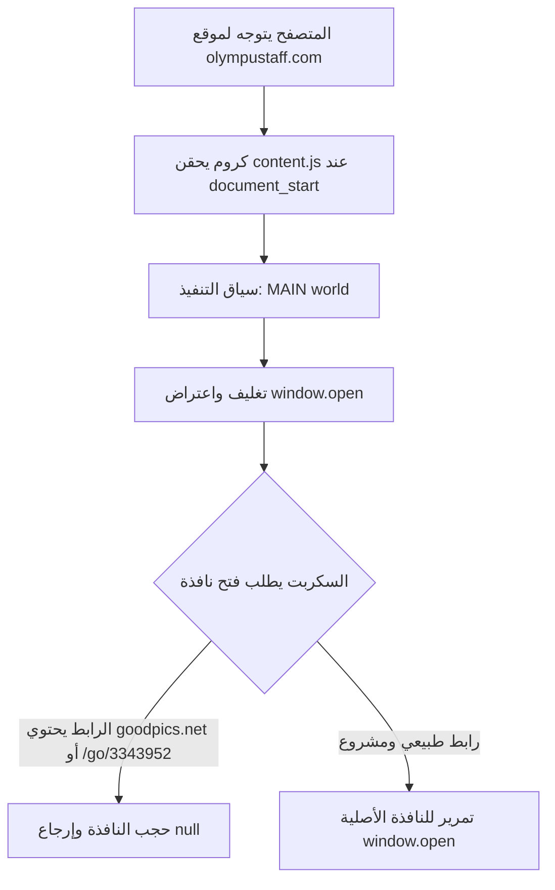

<div align="center">

<a href="https://github.com/shadow-x78/teamx-adsblock">
  
</a>

# TeamX - Ads Block

مانع النوافذ المنبثقة فائق السرعة المخصص لموقع أوليمبوس ستاف (`olympustaff.com`).

[](CHANGELOG.md)
[](LICENSE)


[](docs/AUTO_UPDATE.md)

</div>

---

## اللغة

<a href="README.md">🇬🇧 English</a> · <a href="README_AR.md">🇸🇦 العربية</a>

---

## جدول المحتويات

- [نظرة عامة](#نظرة-عامة)
- [المقارنة](#المقارنة)
- [نطاق العمل](#نطاق-العمل)
- [المميزات](#المميزات)
- [طريقة التثبيت](#طريقة-التثبيت)
- [التحديث التلقائي في الخلفية](#التحديث-التلقائي-في-الخلفية)
- [البنية البرمجية](#البنية-البرمجية)
- [هيكلية المشروع](#هيكلية-المشروع)
- [التوثيق التقني](#التوثيق-التقني)
- [المساهمة](#المساهمة)
- [الترخيص](#الترخيص)

---

<a id="نظرة-عامة"></a>
## نظرة عامة

**TeamX - Ads Block** هي إضافة متصفح خفيفة ومبنية بمعمارية Manifest V3 صُممت خصيصاً للقضاء التام على النوافذ الإعلانية المنبثقة وإعادة التوجيه الإجباري على موقع `olympustaff.com`.

على عكس برامج حجب الإعلانات التقليدية التي تستهلك الذاكرة بقوائم فلاتر ضخمة وتؤخر استجابة تصفح المانجا، تعمل هذه الإضافة عبر حقن مباشر في السياق الأصلي لتنفيذ الصفحة (`world: "MAIN"`) فور لحظة البدء (`document_start`) لاعتراض واستئصال دوال فتح النوافذ الخبيثة (`window.open`) قبل أن تتمكن من فتح أي تبويب مزعج.

---

<a id="المقارنة"></a>
## المقارنة

| الخاصية | برامج الحجب العامة | سكربتات المستخدمين | **TeamX - Ads Block** |
| :--- | :---: | :---: | :---: |
| سياق التنفيذ | ⚠️ Isolated world | ⚠️ Userscript متأخر | ✅ **MAIN World** (`document_start`) |
| اعتراض الأكواد المضمنة | ❌ تفلت السكربتات السريعة | ⚠️ يعتمد على التوقيت | ✅ **اعتراض مضمون 100%** |
| استهلاك الذاكرة | ~100-250 ميجابايت | ~30-60 ميجابايت | ✅ **أقل من 1 ميجابايت (معدوم)** |
| سرعة واستجابة التصفح | تباطؤ ملحوظ في القارئ | تأثير متوسط | ✅ **سرعة أصلية فورية بدون أي تأخير** |
| خصوصية النطاق | ❌ فلاتر عامة لكل المواقع | ⚠️ يتطلب إعداد يدوي | ✅ **موجّه ومحصور بالموقع فقط** |
| التحديث التلقائي الصامت | ⚠️ متجر الإضافات | ⚠️ تحديثات يدوية | ✅ **بروتوكول Omaha الرسمي** |

---

<a id="نطاق-العمل"></a>
## نطاق العمل

تعمل الإضافة حصرياً على الروابط التالية:
- `https://olympustaff.com/*`
- `https://*.olympustaff.com/*`

وتقوم بفحص النوافذ المستهدفة ومنع أي رابط يحتوي على:
- `goodpics.net`
- `/go/3343952`

بينما تعمل جميع الروابط والنوافذ المشروعة الأخرى بشكل طبيعي دون أي اعتراض.

---

<a id="المميزات"></a>
## المميزات

- ⚡ **تنفيذ فوري:** تبدأ فوراً عند `document_start` وقبل اكتمال تحميل عناصر الصفحة.
- 🛡️ **اعتراض من السياق الأصلي:** تعمل في `MAIN World` للوصول المباشر إلى السياق البرمجي للصفحة واعتراض الأوامر المضمنة.
- 🔄 **تحديثات تلقائية بدون تدخل المستخدم:** تدعم بروتوكول التحديث الرسمي لكروم (Omaha Protocol) لسحب التحديثات من GitHub وتثبيتها تلقائياً في الخلفية.
- 🎨 **هوية بصرية أصلية:** أيقونات وشعار فيكتور مستوحى مباشرة من درع TeamX الرسمي لموقع Olympus Staff.
- 🪶 **صفر اعتماديات:** كود جافاسكريبت نقي ونظيف بدون أي مكتبات خارجية.

---

<a id="طريقة-التثبيت"></a>
## طريقة التثبيت

### الطريقة الأولى: عبر ملف `.crx` المجهز (موصى بها للمستخدمين)

1. حمّل أحدث إصدار من ملف [`TeamX-AdsBlock.crx`](https://github.com/shadow-x78/teamx-adsblock/releases/latest/download/TeamX-AdsBlock.crx).
2. افتح صفحة الإضافات في متصفحك:
   ```text
   chrome://extensions/
   ```
3. فعّل **وضع المطور (Developer mode)** في أعلى الصفحة.
4. اسحب ملف `TeamX-AdsBlock.crx` وأفلته داخل الصفحة لتثبيته.

> [!TIP]
> عند التثبيت عبر ملف `.crx`، ستتلقى الإضافة **كافة التحديثات القادمة تلقائياً في الخلفية** مباشرة من هذا المستودع دون الحاجة لإعادة التثبيت يدوياً!

### الطريقة الثانية: تحميل المجلد البرمجي (للمطورين)

```bash
git clone https://github.com/shadow-x78/teamx-adsblock.git
```
1. افتح `chrome://extensions/`.
2. فعّل **وضع المطور**.
3. اضغط على **Load unpacked** واختر المجلد المنسوخ.

---

<a id="التحديث-التلقائي-في-الخلفية"></a>
## التحديث التلقائي في الخلفية

تدعم هذه الإضافة بروتوكول التحديث التلقائي الرسمي من Google (Autoupdate Protocol):
- الإضافة تحتوي على رابط التحديث [`updates.xml`](updates.xml).
- يقوم متصفح كروم دورياً بفحص المستودع في الخلفية للتأكد من وجود إصدارات جديدة.
- عند نشر إصدار جديد، يتم سحب التحديث والتحقق من التوقيع الرقمي وتحديث الإضافة صامتاً دون أن يطلب المتصفح من المستخدم فعل أي شيء.

للاطلاع على التفاصيل البرمجية، راجع [دليل التحديث التلقائي](docs/AUTO_UPDATE.md).

---

<a id="البنية-البرمجية"></a>
## البنية البرمجية



---

<a id="هيكلية-المشروع"></a>
## هيكلية المشروع

```text
teamx-adsblock/
├── .github/
│   └── workflows/
│       └── release.yml          # سير عمل GitHub Actions لحزم وتجهيز الإصدارات
├── assets/
│   └── logo/
│       ├── teamx-adsblock-banner.png     # بانر التوثيق باللغة الإنجليزية
│       ├── teamx-adsblock-banner-ar.png  # بانر التوثيق باللغة العربية
│       └── teamx-adsblock-logo.png       # الشعار الأساسي فائق الدقة
├── docs/
│   ├── ARCHITECTURE.md          # المعمارية التقنية ودورة حياة الاعتراض
│   ├── AUTO_UPDATE.md           # بروتوكول Omaha والتحديث الصامت
│   └── INSTALLATION.md          # خطوات التثبيت المفصلة لمختلف المتصفحات
├── icons/
│   ├── icon16.png               # حجم شريط المتصفح والـ Favicon
│   ├── icon32.png               # شاشات العرض عالية الدقة Retina
│   ├── icon48.png               # شاشة إدارة الإضافات
│   ├── icon128.png              # شاشة متجر كروم والتثبيت
│   └── icon512.png              # الأيقونة الأصلية
├── content.js                   # كود الاعتراض والحظر بسياق MAIN world
├── manifest.json                # إعدادات الإضافة بمعمارية Manifest V3
├── updates.xml                  # ملف بروتوكول التحديث التلقائي لكروم
├── CHANGELOG.md                 # سجل التغييرات الدلالي
├── CODE_OF_CONDUCT.md           # ميثاق السلوك للمساهمين
├── CONTRIBUTING.md              # إرشادات المساهمة والتطوير
├── LICENSE                      # رخصة MIT المفتوحة
├── README.md                    # التوثيق بالإنجليزية
├── README_AR.md                 # التوثيق بالعربية
└── SECURITY.md                  # سياسة الأمان والإبلاغ عن الثغرات
```

---

<a id="التوثيق-التقني"></a>
## التوثيق التقني

| المستند | الوصف |
| :--- | :--- |
| [ARCHITECTURE.md](docs/ARCHITECTURE.md) | شرح بنية الكود وسياق MAIN world واعتراض دوال window.open |
| [AUTO_UPDATE.md](docs/AUTO_UPDATE.md) | شرح بروتوكول التحديث لكروم ومفاتيح التوقيع الرقمي وإطلاق الإصدارات |
| [INSTALLATION.md](docs/INSTALLATION.md) | خطوات التثبيت المفصلة لمختلف متصفحات Chromium |

---

<a id="المساهمة"></a>
## المساهمة

1. أنشئ تفريعاً (Fork) للمستودع وأنشئ فرعك الخاص (`feature/xyz`).
2. التزم بنمط الكوميت الموحد: `teamx-adsblock | <type>: <description>`.
3. حافظ على كود جافاسكريبت أصلي نقي بدون اعتماديات.
4. اختبر التوافق مباشرة مع موقع `olympustaff.com`.
5. افتح Pull Request.

يرجى مراجعة [إرشادات المساهمة](CONTRIBUTING.md) و [ميثاق السلوك](CODE_OF_CONDUCT.md).

---

<a id="الترخيص"></a>
## الترخيص

مرخصة بموجب ترخيص [MIT License](LICENSE).

---

<div align="center">

صُنعت بواسطة <a href="https://github.com/shadow-x78">shadow-x78</a> ·
[سجل التغييرات](CHANGELOG.md) ·
[الأمان](SECURITY.md)

<sub>&copy; 2026 TeamX - Ads Block</sub>

</div>
