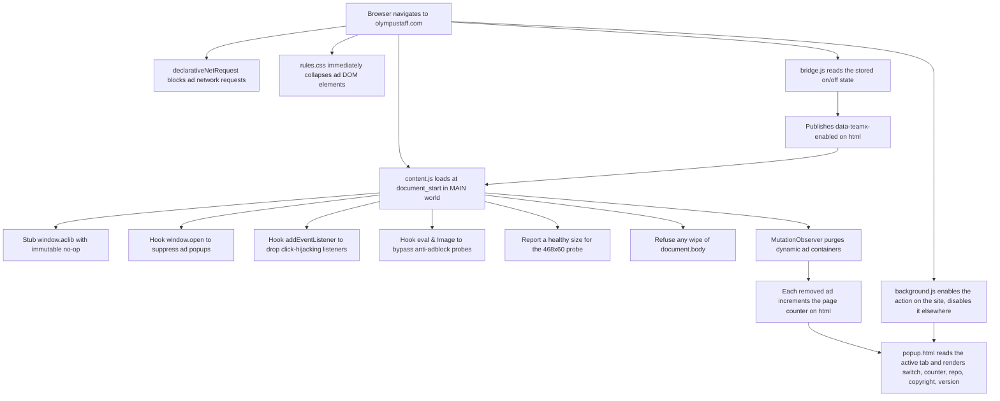

<div align="center">

# Architecture - TeamX - AdBlock

[](../CHANGELOG.md)
[](../LICENSE)


</div>

---

## Language

<a href="ARCHITECTURE.md">🇬🇧 English</a> · <a href="ARCHITECTURE_AR.md">🇸🇦 العربية</a>

---

## Table of Contents

- [Overview](#overview)
- [Execution Context](#execution-context)
- [Interception Mechanics](#interception-mechanics)
- [Toolbar Popup](#popup)
- [Performance & Security](#performance--security)

---

<a id="overview"></a>
## Overview

`TeamX - AdBlock` operates a multi-layered defense architecture specifically optimized for `olympustaff.com` to eliminate all ads, popups, and anti-adblock modals:



---

<a id="execution-context"></a>
## Execution Context

Most traditional adblockers inject scripts into an **Isolated World** (the default execution environment for extension content scripts). However, inline scripts executing in the page's original context (`MAIN` world) cannot be directly intercepted if they define or cache global functions before the isolated world can attach listeners.

By declaring:
```json
"world": "MAIN",
"run_at": "document_start"
```
the extension guarantees that its wrapper runs before any inline scripts or external trackers on the host page have initialized, securing total interception fidelity.

---

<a id="interception-mechanics"></a>
## Interception Mechanics

```javascript
// TeamX - AdBlock (MIT)
// https://github.com/shadow-x78/teamx-adblock

(() => {
  const originalOpen = window.open;

  window.open = function (url) {
    const host = new URL(String(url), window.location.href).hostname;
    const trusted = host === "olympustaff.com" || host.endsWith(".olympustaff.com");
    if (!trusted) {
      return null;
    }
    return originalOpen.apply(this, arguments);
  };
})();
```

- **Clean passthrough**: `arguments` and `this` context are faithfully preserved.
- **Strict suppression**: Any destination outside `olympustaff.com` immediately returns `null` and terminates the popup lifecycle.
- **Label-boundary trust**: `fakeolympustaff.com` is rejected, so look-alike hosts cannot slip through the allowlist.

---

<a id="popup"></a>
## Toolbar Popup

`popup.html` is a 316px panel opened from the toolbar icon. It has no logic of
its own beyond reading storage:

| Element | Source |
| --- | --- |
| Protection switch | `chrome.storage.local.enabled` |
| Blocked ads | `<html data-teamx-blocked>` of the active tab |
| Language | `chrome.storage.local.lang` (`ar` default, `en` optional) |
| Repository link | `manifest.homepage_url` |
| Version | `chrome.runtime.getManifest().version` |
| Copyright | `manifest.author` + current year |

Toggling the switch writes the new state, enables or disables the
`ruleset_1` declarative ruleset, and reloads any open site tab so the
page-context defenses are installed (or removed) on a clean document.

The panel is a single centered column: every block is the same width and every
line of text is centered, so all elements share one axis in both writing
directions. Language is resolved from a small in-file dictionary (`ar`, `en`);
switching it sets `documentElement.lang` and `dir`, updates every label, moves
the switch thumb along the new writing direction, and persists `lang` so the
next opening keeps the choice. The protection state is persisted the same way,
so both preferences survive browser restarts.

The counter belongs to the page that produced it: `content.js` keeps it on
`<html data-teamx-blocked>`, so every load starts at zero and a reload never
accumulates. The panel reads that attribute from the active tab, and only when
that tab is the site.

`background.js` is the service worker. It enables the toolbar action on
`olympustaff.com` and disables it on every other tab, so the icon is greyed out
and cannot be clicked away from the site, and it re-syncs on tab activation,
navigation, and window focus.

---

<a id="performance--security"></a>
## Performance & Security

- Zero CPU overhead while browsing or reading manga chapters.
- No network requests, telemetry, or third-party analytic pings.
- Native Chrome sandbox isolation for local script safety.
- Observer callbacks are coalesced into a single animation frame, so a busy page no longer triggers a full-document scan per mutation.
- Set `window.__TEAMX_DEBUG__ = true` to surface swallowed hook failures in the console.

---

<div align="center">

Built by <a href="https://github.com/shadow-x78">shadow-x78</a> ·
[Changelog](../CHANGELOG.md) ·
[Security](../SECURITY.md)

<sub>&copy; 2026 TeamX - AdBlock</sub>

</div>
