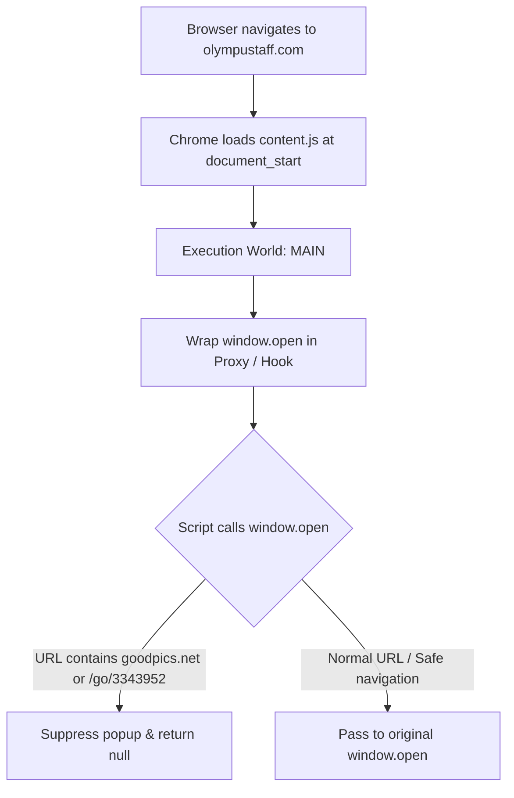

# Architecture & Technical Design

## Overview

`TeamX - Ads Block` is an ultra-lightweight Chrome Extension (Manifest V3) purpose-built to intercept and neutralize rogue ad popups on `olympustaff.com` without disturbing legitimate browsing or website scripts.



## Manifest V3 & Execution World

Most traditional adblockers inject scripts into an **Isolated World** (the default execution environment for extension content scripts). However, inline scripts executing in the page's original context (`MAIN` world) cannot be directly intercepted if they define or cache global functions before the isolated world can attach listeners.

By declaring:
```json
"world": "MAIN",
"run_at": "document_start"
```
the extension guarantees that its wrapper runs before any inline scripts or external trackers on the host page have initialized, securing total interception fidelity.

## Popup Interception Logic

```javascript
(() => {
  const originalOpen = window.open;

  window.open = function (url) {
    if (url && (String(url).includes("goodpics.net") || String(url).includes("/go/3343952"))) {
      return null;
    }
    return originalOpen.apply(this, arguments);
  };
})();
```

- **Clean passthrough**: `arguments` and `this` context are faithfully preserved.
- **Strict suppression**: Blacklisted domains immediately return `null` and terminate the popup lifecycle.
