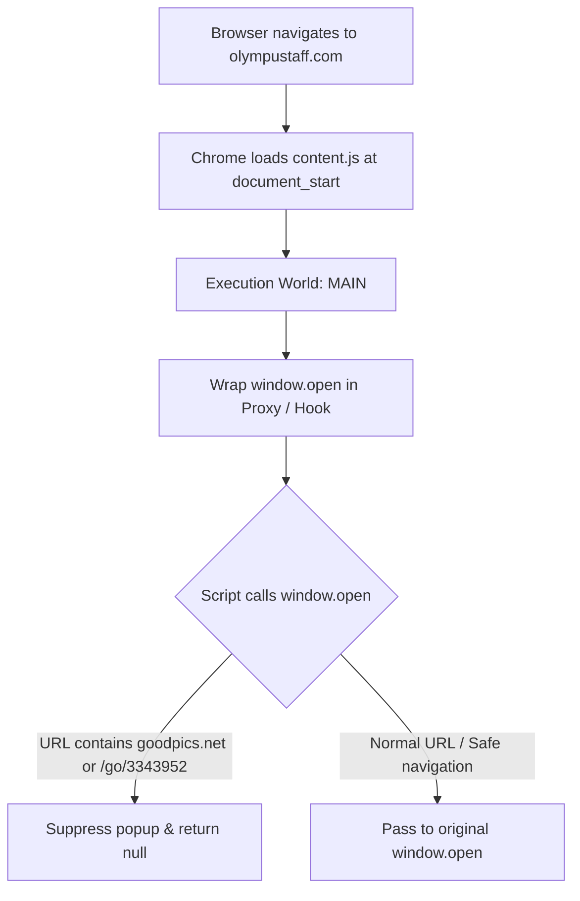

<div align="center">

# Architecture - TeamX - AdBlock

[](../CHANGELOG.md)
[](../LICENSE)


</div>

---

## Table of Contents

- [Overview](#overview)
- [Execution Context](#execution-context)
- [Interception Mechanics](#interception-mechanics)
- [Performance & Security](#performance--security)

---

<a id="overview"></a>
## Overview

`TeamX - AdBlock` is an ultra-lightweight Chrome Extension (Manifest V3) purpose-built to intercept and neutralize rogue ad popups on `olympustaff.com` without disturbing legitimate browsing or website scripts.



---

<a id="execution-context"></a>
## Execution Context

Most traditional adblockers inject scripts into an **Isolated World** (the default execution environment for extension content scripts). However, inline scripts executing in the page's original context (`MAIN` world) cannot be directly intercepted if they define or cache global functions before the isolated world can attach listeners.

By declaring:
```json
"world": "MAIN",
"run_at": "document_start"
```
the extension guarantees that its wrapper runs before any inline scripts or external trackers on the host page have initialized, securing total interception fidelity.

---

<a id="interception-mechanics"></a>
## Interception Mechanics

```javascript
// TeamX - AdBlock (MIT)
// https://github.com/shadow-x78/teamx-adblock

(() => {
  const originalOpen = window.open;

  window.open = function (url) {
    if (url && (String(url).includes("goodpics.net") || String(url).includes("/go/3343952"))) {
      return null;
    }
    return originalOpen.apply(this, arguments);
  };
})();
```

- **Clean passthrough**: `arguments` and `this` context are faithfully preserved.
- **Strict suppression**: Blacklisted domains immediately return `null` and terminate the popup lifecycle.

---

<a id="performance--security"></a>
## Performance & Security

- Zero CPU overhead while browsing or reading manga chapters.
- No network requests, telemetry, or third-party analytic pings.
- Native Chrome sandbox isolation for local script safety.

---

<div align="center">

Built by <a href="https://github.com/shadow-x78">shadow-x78</a> ·
[Changelog](../CHANGELOG.md) ·
[Security](../SECURITY.md)

<sub>&copy; 2026 TeamX - AdBlock</sub>

</div>
