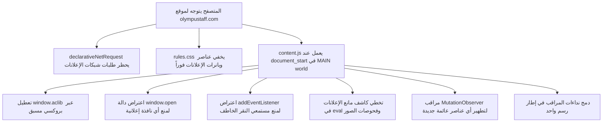

<div align="center">

# البنية البرمجية والمعمارية - TeamX - AdBlock

[](../CHANGELOG.md)
[](../LICENSE)


</div>

---

## اللغة

<a href="ARCHITECTURE.md">🇬🇧 English</a> · <a href="ARCHITECTURE_AR.md">🇸🇦 العربية</a>

---

## جدول المحتويات

- [نظرة عامة](#نظرة-عامة)
- [سياق التنفيذ في Manifest V3](#سياق-التنفيذ)
- [آلية اعتراض النوافذ المنبثقة](#آلية-الاعتراض)
- [الأداء والأمان](#الأداء-والأمان)

---

<a id="نظرة-عامة"></a>
## نظرة عامة

تعتمد **TeamX - AdBlock** معمارية دفاعية متعددة الطبقات مخصصة لموقع `olympustaff.com` لإبادة كافة أشكال الإعلانات، البانرات، النوافذ المنبثقة، وتخطي رسائل حظر مانع الإعلانات:



---

<a id="سياق-التنفيذ"></a>
## سياق التنفيذ في Manifest V3

تقوم معظم أدوات حظر الإعلانات بحقن السكربتات في بيئة معزولة تسمى **Isolated World** (البيئة الافتراضية لسكربتات الإضافات). لكن في هذه البيئة المعزولة، لا يمكن اعتراض السكربتات المضمنة مباشرة داخل كود الصفحة (`MAIN` world) إذا تم تنفيذها قبل تهيئة البيئة المعزولة.

من خلال الإعلان الصريح في `manifest.json`:
```json
"world": "MAIN",
"run_at": "document_start"
```
تضمن الإضافة تنفيذ كود الاعتراض في نفس السياق البرمجي للصفحة فور لحظة البدء، وقبل أن تتمكن أي سكربتات تتبع أو إعلانات من العمل أو حفظ مراجع للدوال الأصلية.

---

<a id="آلية-الاعتراض"></a>
## آلية اعتراض النوافذ المنبثقة

```javascript
// TeamX - AdBlock (MIT)
// https://github.com/shadow-x78/teamx-adblock

(() => {
  const originalOpen = window.open;

  window.open = function (url) {
    const host = new URL(String(url), window.location.href).hostname;
    const trusted = host === "olympustaff.com" || host.endsWith(".olympustaff.com");
    if (!trusted) {
      return null;
    }
    return originalOpen.apply(this, arguments);
  };
})();
```

- **تمرير طبيعي:** يتم الحفاظ على سياق `this` وجميع المعاملات `arguments` للنوافذ العادية.
- **إخماد صارم:** أي وجهة خارج `olympustaff.com` تُمنع فوراً وإرجاع `null` لإيقاف دورة حياة النافذة المنبثقة.
- **ثقة بحدود النطاق:** يُرفض المضيف `fakeolympustaff.com` فلا تتجاوز النطاقات المشابهة قائمة الثقة.

---

<a id="الأداء-والأمان"></a>
## الأداء والأمان

- استهلاك المعالج والذاكرة شبه معدوم (< 1 ميجابايت).
- لا ترسل أي بيانات أو تحليلات عبر الشبكة (Zero Telemetry).
- تعمل ضمن ضوابط الأمان الصارمة لمتصفحات كروميوم.
- تُدمج نداءات المراقب في إطار رسم واحد، فلا تتسبب الصفحة النشطة في مسح كامل للمستند عند كل تغيير.
- اضبط `window.__TEAMX_DEBUG__ = true` لإظهار الأعطال التي كان يتم ابتلاعها في وحدة التحكم.

---

<div align="center">

صُنعت بواسطة <a href="https://github.com/shadow-x78">shadow-x78</a> ·
[سجل التغييرات](../CHANGELOG.md) ·
[الأمان](../SECURITY.md)

<sub>&copy; 2026 TeamX - AdBlock</sub>

</div>

