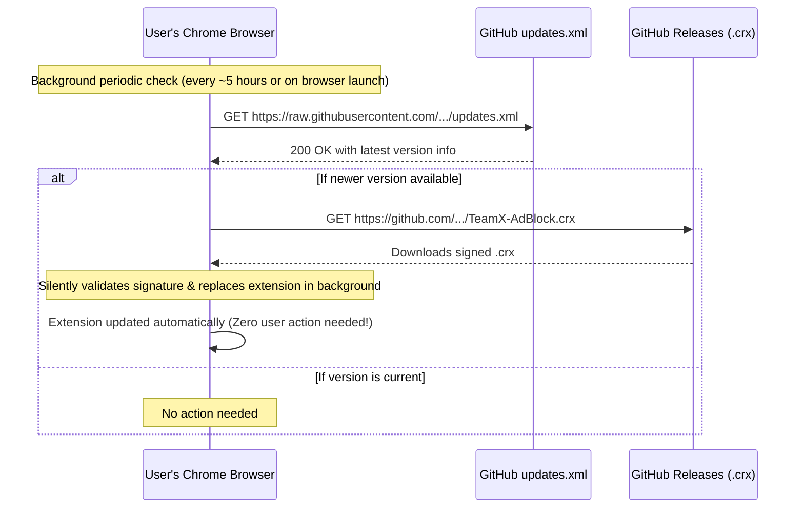

<div align="center">

# Auto-Updates - TeamX - AdBlock

[](../CHANGELOG.md)
[](../LICENSE)


</div>

---

## Language

<a href="AUTO_UPDATE.md">🇬🇧 English</a> · <a href="AUTO_UPDATE_AR.md">🇸🇦 العربية</a>

---

## Table of Contents

- [Overview](#overview)
- [How Auto-Updates Work](#how-auto-updates-work)
- [Extension ID & Key Consistency](#extension-id)
- [Configuration Files](#configuration-files)
- [Release Process](#release-process)

---

<a id="overview"></a>
## Overview

Chrome extensions distributed outside the Chrome Web Store can update automatically using Google's **Autoupdate Protocol** (Omaha update protocol).

---

<a id="how-auto-updates-work"></a>
## How Auto-Updates Work



---

<a id="extension-id"></a>
## Extension ID & Key Consistency

In Chromium browsers, an extension's ID is deterministically computed from the public key matching its private key (`.pem`):

- **Private Key**: `TeamX-AdsBlock.pem` (kept securely by author, never committed to git)
- **Extension ID**: `cnefeiflkeegmadihlfffchlmnmfedmd`

> [!IMPORTANT]
> To allow automatic updates, every new version of `TeamX-AdBlock.crx` MUST be signed with the **same** private key (`TeamX-AdsBlock.pem`).

---

<a id="configuration-files"></a>
## Configuration Files

### In `manifest.json`:
```json
"update_url": "https://raw.githubusercontent.com/shadow-x78/teamx-adblock/main/updates.xml"
```

### In `updates.xml`:
```xml
<?xml version='1.0' encoding='UTF-8'?>
<gupdate xmlns='http://www.google.com/update2/response' protocol='2.0'>
  <app appid='cnefeiflkeegmadihlfffchlmnmfedmd'>
    <updatecheck codebase='https://github.com/shadow-x78/teamx-adblock/releases/latest/download/TeamX-AdBlock.crx' version='1.2.0' />
  </app>
</gupdate>
```

---

<a id="release-process"></a>
## Release Process

When deploying an update to all users:

1. Increment the `"version"` field in `manifest.json` (e.g. from `"1.2.0"` to `"1.3.0"`).
2. Increment the `version` attribute in `updates.xml` to match (`version='1.3.0'`).
3. Commit and push your changes to GitHub:
   ```bash
   git commit -m "teamx-adblock | v1.3.0 | release: update ad filter rules"
   ```
4. Pack the new `.crx` file:
   ```bash
   google-chrome --pack-extension=. --pack-extension-key=<path-outside-repo>/TeamX-AdsBlock.pem
   ```
5. Create a new GitHub Release with the tag `v1.3.0` and upload the generated `TeamX-AdBlock.crx`.

Once published, all users' Chrome browsers will automatically pull the update within hours without requiring any manual clicks or intervention!

---

<div align="center">

Built by <a href="https://github.com/shadow-x78">shadow-x78</a> ·
[Changelog](../CHANGELOG.md) ·
[Security](../SECURITY.md)

<sub>&copy; 2026 TeamX - AdBlock</sub>

</div>
