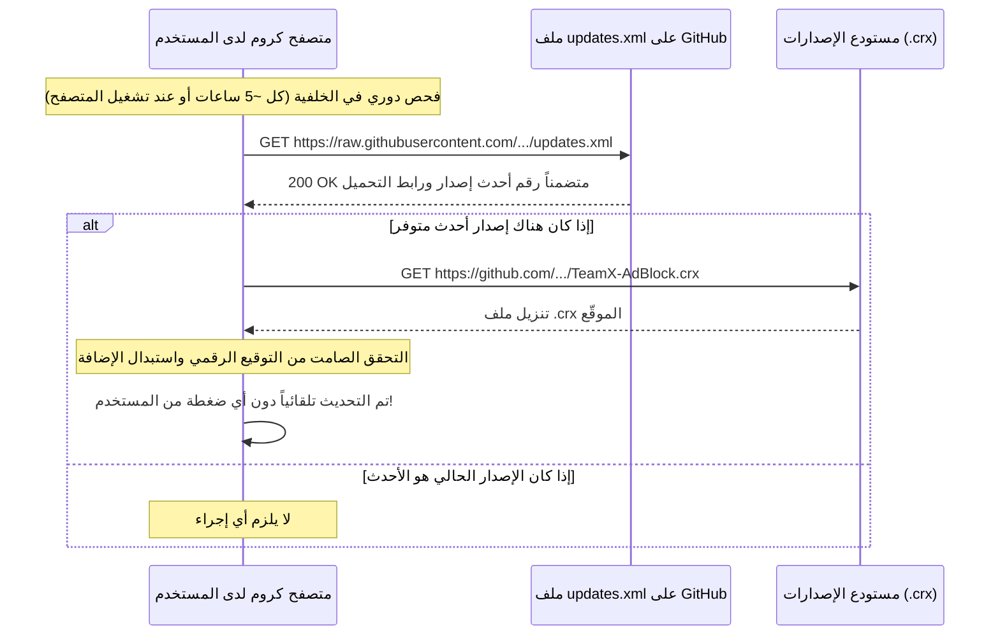

<div align="center">

# التحديث التلقائي - TeamX - AdBlock

[](../CHANGELOG.md)
[](../LICENSE)


</div>

---

## اللغة

<a href="AUTO_UPDATE.md">🇬🇧 English</a> · <a href="AUTO_UPDATE_AR.md">🇸🇦 العربية</a>

---

## جدول المحتويات

- [نظرة عامة](#نظرة-عامة)
- [كيف يعمل التحديث التلقائي](#كيف-يعمل)
- [ثبات معرّف الإضافة والتوقيع الرقمي](#معرف-الإضافة)
- [ملفات التهيئة](#ملفات-التهيئة)
- [إطلاق إصدار جديد للمستخدمين](#إطلاق-إصدار)

---

<a id="نظرة-عامة"></a>
## نظرة عامة

يمكن للإضافات المثبتة خارج متجر كروم الإلكتروني أن تتلقى التحديثات بصورة تلقائية وصامتة تماماً عبر **بروتوكول التحديث الرسمي من جوجل (Omaha Autoupdate Protocol)**.

---

<a id="كيف-يعمل"></a>
## كيف يعمل التحديث التلقائي



---

<a id="معرف-الإضافة"></a>
## ثبات معرّف الإضافة والتوقيع الرقمي

في متصفحات كروميوم، يُحسب معرّف الإضافة (Extension ID) بطريقة رياضية ثابتة مشتقة من المفتاح العام المطابق للمفتاح الخاص (`.pem`):

- **المفتاح الخاص:** `TeamX-AdsBlock.pem` (يُحفظ بأمان لدى المطور ولا يُرفع على المستودع)
- **معرّف الإضافة:** `cnefeiflkeegmadihlfffchlmnmfedmd`

> [!IMPORTANT]
> للسماح بالتحديث التلقائي الصامت، يجب حزم وتوقيع كل إصدار جديد من `TeamX-AdBlock.crx` باستخدام **نفس المفتاح الخاص الأصلي**.

---

<a id="ملفات-التهيئة"></a>
## ملفات التهيئة

### في `manifest.json`:
```json
"update_url": "https://raw.githubusercontent.com/shadow-x78/teamx-adblock/main/updates.xml"
```

### في `updates.xml`:
```xml
<?xml version='1.0' encoding='UTF-8'?>
<gupdate xmlns='http://www.google.com/update2/response' protocol='2.0'>
  <app appid='cnefeiflkeegmadihlfffchlmnmfedmd'>
    <updatecheck codebase='https://github.com/shadow-x78/teamx-adblock/releases/latest/download/TeamX-AdBlock.crx' version='1.2.0' />
  </app>
</gupdate>
```

---

<a id="إطلاق-إصدار"></a>
## إطلاق إصدار جديد للمستخدمين

عند رغبتك في نشر تحديث ليصل تلقائياً إلى كافة المستخدمين:

1. ارفع رقم الإصدار في `manifest.json` (مثلاً من `"1.2.0"` إلى `"1.3.0"`).
2. ارفع رقم الإصدار في `updates.xml` إلى نفس القيمة (`version='1.3.0'`).
3. احزم ملف الـ `.crx` الجديد بالمفتاح الخاص:
   ```bash
   google-chrome --pack-extension=. --pack-extension-key=../TeamX-AdsBlock.pem
   ```
4. ارفع التغييرات إلى GitHub واصنع Release جديداً بالوسم `v1.3.0` وارفق ملف `TeamX-AdBlock.crx`.

خلال ساعات قليلة، سيقوم متصفح كروم لدى جميع المستخدمين بسحب التحديث وتثبيته في الخلفية فوراً وبدون أي تدخل يدوي!

---

<div align="center">

صُنعت بواسطة <a href="https://github.com/shadow-x78">shadow-x78</a> ·
[سجل التغييرات](../CHANGELOG.md) ·
[الأمان](../SECURITY.md)

<sub>&copy; 2026 TeamX - AdBlock</sub>

</div>
