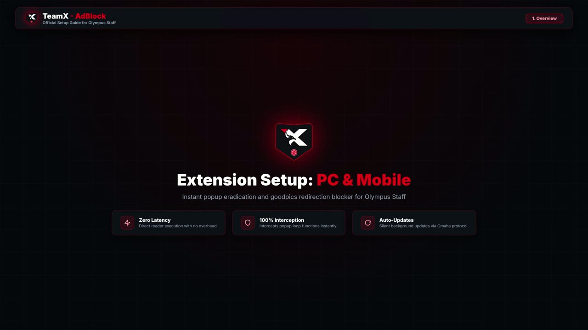
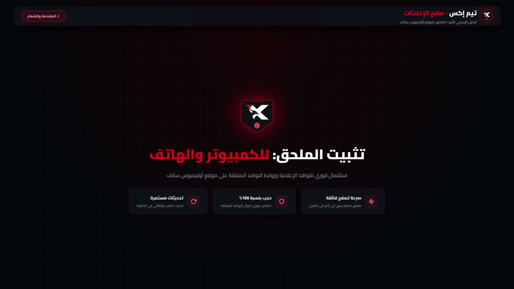

<div align="center">

# Video Tutorial Guide - TeamX - AdBlock

[](../CHANGELOG.md)
[](../LICENSE)


</div>

---

## Language

<a href="VIDEO_TUTORIAL.md">🇬🇧 English</a> · <a href="VIDEO_TUTORIAL_AR.md">🇸🇦 العربية</a>

---

## Table of Contents

- [Overview](#overview)
- [Watch the Tutorial](#watch-the-tutorial)
- [Media Specifications](#media-specifications)
- [Chapter Breakdown](#chapter-breakdown)
- [Offline Playback](#offline-playback)
- [Why There Is No Embedded Player](#embedded-player)

---

<a id="overview"></a>
## Overview

Two recorded walkthroughs cover the complete setup of **TeamX - AdBlock** on desktop and on mobile. Both files are committed to the repository under `assets/videos/`, so they stay versioned together with the extension code.

| Language | Video File | Poster Frame | Duration |
| :--- | :--- | :--- | :---: |
| 🇬🇧 English | [`TeamX_AdBlock_Tutorial_EN.mp4`](../assets/videos/TeamX_AdBlock_Tutorial_EN.mp4) | [`TeamX_AdBlock_Tutorial_EN_poster.jpg`](../assets/videos/TeamX_AdBlock_Tutorial_EN_poster.jpg) | 00:52 |
| 🇸🇦 العربية | [`TeamX_AdBlock_Tutorial_AR.mp4`](../assets/videos/TeamX_AdBlock_Tutorial_AR.mp4) | [`TeamX_AdBlock_Tutorial_AR_poster.jpg`](../assets/videos/TeamX_AdBlock_Tutorial_AR_poster.jpg) | 00:56 |

---

<a id="watch-the-tutorial"></a>
## Watch the Tutorial

### 🇬🇧 English

[](https://cdn.jsdelivr.net/gh/shadow-x78/teamx-adblock@main/assets/videos/TeamX_AdBlock_Tutorial_EN.mp4)

▶ **Watch the English walkthrough** — [Download MP4](https://raw.githubusercontent.com/shadow-x78/teamx-adblock/main/assets/videos/TeamX_AdBlock_Tutorial_EN.mp4) · [Open in repository](https://github.com/shadow-x78/teamx-adblock/blob/main/assets/videos/TeamX_AdBlock_Tutorial_EN.mp4)

### 🇸🇦 العربية

[](https://cdn.jsdelivr.net/gh/shadow-x78/teamx-adblock@main/assets/videos/TeamX_AdBlock_Tutorial_AR.mp4)

▶ **شاهد الدليل بالعربية** — [تحميل ملف MP4](https://raw.githubusercontent.com/shadow-x78/teamx-adblock/main/assets/videos/TeamX_AdBlock_Tutorial_AR.mp4) · [فتح داخل المستودع](https://github.com/shadow-x78/teamx-adblock/blob/main/assets/videos/TeamX_AdBlock_Tutorial_AR.mp4)

---

<a id="media-specifications"></a>
## Media Specifications

| Property | English | Arabic |
| :--- | :--- | :--- |
| Container | MP4 (ISO Base Media) | MP4 (ISO Base Media) |
| Video codec | H.264 High Profile, Level 4.0 | H.264 High Profile, Level 4.0 |
| Audio codec | AAC-LC, 48 kHz, stereo | AAC-LC, 48 kHz, stereo |
| Resolution | 1920×1080 (16:9) | 1920×1080 (16:9) |
| Frame rate | 30 fps | 30 fps |
| Duration | 00:52 | 00:56 |
| File size | 4.73 MB | 4.77 MB |

H.264 with AAC audio is the combination supported natively by every current Chromium browser (Chrome, Brave, Edge, Kiwi), by Gecko (Firefox 109+), and by the Android system player, so the files play without any transcoding step.

---

<a id="chapter-breakdown"></a>
## Chapter Breakdown

Both recordings follow the same three-part structure:

| # | Chapter | Content |
| :---: | :--- | :--- |
| 1 | **Overview** | Brand identity, extension purpose, and the three guarantees: zero latency, 100% interception, and automatic updates |
| 2 | **PC Setup** | Loading the `.crx` package on Chrome / Chromium through the developer mode in `chrome://extensions/` |
| 3 | **Mobile Setup** | Installing Kiwi Browser from Google Play and loading the `.crx` package on Android |

The written equivalent of every step is kept in the [Installation Guide](INSTALLATION.md) and its [Arabic counterpart](INSTALLATION_AR.md).

---

<a id="offline-playback"></a>
## Offline Playback

Download the file and open it with any player (VLC, MPV, Windows Media Player, QuickTime):

```bash
curl -L -o TeamX_AdBlock_Tutorial_EN.mp4 https://raw.githubusercontent.com/shadow-x78/teamx-adblock/main/assets/videos/TeamX_AdBlock_Tutorial_EN.mp4
```

The video is a standalone walkthrough; the extension itself is installed separately as described in the [Installation Guide](INSTALLATION.md).

---

<a id="embedded-player"></a>
## Why There Is No Embedded Player

GitHub renders Markdown on the server and sanitizes the produced HTML. Raw `<video>` elements that point at files inside the repository are removed from the output, and a committed media file referenced with image syntax is rendered as a broken image instead of a player. The repository therefore uses a poster frame that links to the MP4 through a CDN that serves the correct `video/mp4` content type, which opens the full-resolution recording directly in the browser.

To obtain a truly inline player on GitHub itself, upload the MP4 through the GitHub web editor (`Attach files by dragging & dropping, selecting from a file browser, or pasting`) and reference the generated `https://github.com/user-attachments/assets/...` URL, which GitHub renders as an inline player.

---

<div align="center">

Built by <a href="https://github.com/shadow-x78">shadow-x78</a> ·
[Changelog](../CHANGELOG.md) ·
[Security](../SECURITY.md)

<sub>&copy; 2026 TeamX - AdBlock</sub>

</div>
