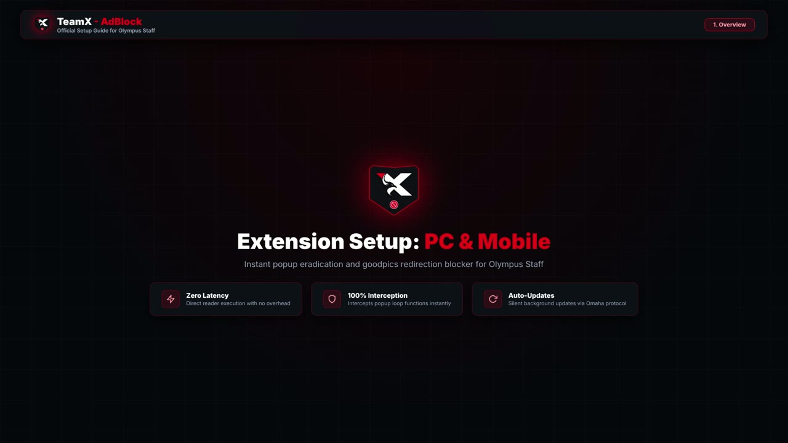
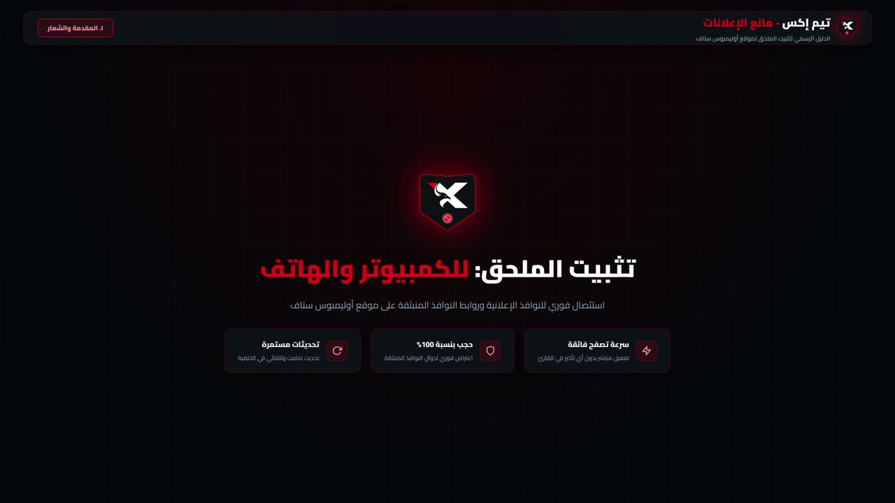

<div align="center">

# دليل فيديو الشرح - TeamX - AdBlock

[](../CHANGELOG.md)
[](../LICENSE)


</div>

---

## اللغة

<a href="VIDEO_TUTORIAL.md">🇬🇧 English</a> · <a href="VIDEO_TUTORIAL_AR.md">🇸🇦 العربية</a>

---

## جدول المحتويات

- [نظرة عامة](#نظرة-عامة)
- [مشاهدة الدليل](#مشاهدة-الدليل)
- [المواصفات الفنية](#المواصفات-الفنية)
- [فصول الدليل](#فصول-الدليل)
- [المشاهدة بدون إنترنت](#المشاهدة-بدون-إنترنت)
- [لماذا لا يوجد مشغّل مدمج؟](#المشغل-المدمج)

---

<a id="نظرة-عامة"></a>
## نظرة عامة

يوجد فيديوان مسجّلان يغطيان خطوات التثبيت الكاملة لإضافة **TeamX - AdBlock** على الكمبيوتر وعلى الهاتف. كلا الملفين مُودَع داخل المستودع ضمن مجلد `assets/videos/` ليبقىا متزامنين مع كود الإضافة.

| اللغة | ملف الفيديو | صورة الغلاف | المدة |
| :--- | :--- | :--- | :---: |
| 🇬🇧 الإنجليزية | [`TeamX_AdBlock_Tutorial_EN.mp4`](../assets/videos/TeamX_AdBlock_Tutorial_EN.mp4) | [`TeamX_AdBlock_Tutorial_EN_poster.jpg`](../assets/videos/TeamX_AdBlock_Tutorial_EN_poster.jpg) | 00:52 |
| 🇸🇦 العربية | [`TeamX_AdBlock_Tutorial_AR.mp4`](../assets/videos/TeamX_AdBlock_Tutorial_AR.mp4) | [`TeamX_AdBlock_Tutorial_AR_poster.jpg`](../assets/videos/TeamX_AdBlock_Tutorial_AR_poster.jpg) | 00:56 |

---

<a id="مشاهدة-الدليل"></a>
## مشاهدة الدليل

### 🇬🇧 English

[](https://cdn.jsdelivr.net/gh/shadow-x78/teamx-adblock@main/assets/videos/TeamX_AdBlock_Tutorial_EN.mp4)

▶ **Watch the English walkthrough** — [Download MP4](https://raw.githubusercontent.com/shadow-x78/teamx-adblock/main/assets/videos/TeamX_AdBlock_Tutorial_EN.mp4) · [Open in repository](https://github.com/shadow-x78/teamx-adblock/blob/main/assets/videos/TeamX_AdBlock_Tutorial_EN.mp4)

### 🇸🇦 العربية

[](https://cdn.jsdelivr.net/gh/shadow-x78/teamx-adblock@main/assets/videos/TeamX_AdBlock_Tutorial_AR.mp4)

▶ **شاهد الدليل بالعربية** — [تحميل ملف MP4](https://raw.githubusercontent.com/shadow-x78/teamx-adblock/main/assets/videos/TeamX_AdBlock_Tutorial_AR.mp4) · [فتح داخل المستودع](https://github.com/shadow-x78/teamx-adblock/blob/main/assets/videos/TeamX_AdBlock_Tutorial_AR.mp4)

---

<a id="المواصفات-الفنية"></a>
## المواصفات الفنية

| الخاصية | الإنجليزية | العربية |
| :--- | :--- | :--- |
| حاوية الملف | MP4 (ISO Base Media) | MP4 (ISO Base Media) |
| ترميز الفيديو | H.264 High Profile, Level 4.0 | H.264 High Profile, Level 4.0 |
| ترميز الصوت | AAC-LC, 48 kHz, استريو | AAC-LC, 48 kHz, استريو |
| الدقة | 1920×1080 (16:9) | 1920×1080 (16:9) |
| عدد الإطارات | 30 إطار/ثانية | 30 إطار/ثانية |
| المدة | 00:52 | 00:56 |
| حجم الملف | 4.73 MB | 4.77 MB |

ترميز H.264 مع صوت AAC هو المزيج المدعوم أصلاً في جميع متصفحات كروميوم الحالية (كروم، بريف، إيدج، Kiwi)، وفي محرك جيكو (فايرفوكس 109+)، وفي مشغّل أندرويد النظامي، لذا تعمل الملفات دون أي إعادة ترميز.

---

<a id="فصول-الدليل"></a>
## فصول الدليل

يسير التسجيلان على الهيكل الثلاثي نفسه:

| # | الفصل | المحتوى |
| :---: | :--- | :--- |
| 1 | **نظرة عامة** | الهوية البصرية، هدف الإضافة، والضمانات الثلاث: صفر تأخير، اعتراض 100%، وتحديثات تلقائية |
| 2 | **التثبيت على الكمبيوتر** | تثبيت حزمة `.crx` على كروم / كروميوم عبر وضع المطوّر في `chrome://extensions/` |
| 3 | **التثبيت على الهاتف** | تثبيت متصفح Kiwi من متجر Google Play وتحميل حزمة `.crx` على أندرويد |

النص المكتوب المكافئ لكل خطوة موجود في [دليل التثبيت](INSTALLATION_AR.md) ونسخته [الإنجليزية](INSTALLATION.md).

---

<a id="المشاهدة-بدون-إنترنت"></a>
## المشاهدة بدون إنترنت

حمّل الملف ثم افتحه بأي مشغّل (VLC، MPV، Windows Media Player، QuickTime):

```bash
curl -L -o TeamX_AdBlock_Tutorial_AR.mp4 https://raw.githubusercontent.com/shadow-x78/teamx-adblock/main/assets/videos/TeamX_AdBlock_Tutorial_AR.mp4
```

الفيديو دليل مستقل بذاته، أما الإضافة فتُثبَّت بشكل منفصل حسب الخطوات في [دليل التثبيت](INSTALLATION_AR.md).

---

<a id="المشغل-المدمج"></a>
## لماذا لا يوجد مشغّل مدمج؟

يقوم GitHub بمعالجة ملفات Markdown على الخادم ثم ينقّي ناتج HTML. تُحذف وسوم `<video>` التي تشير إلى ملفات داخل المستودع، كما يُعرض ملف الفيديو المُودَع باستخدام صيغة الصورة على شكل صورة معطوبة بدل مشغّل. لذلك يعتمد المستودع على صورة غلاف مرتبطة بملف الفيديو عبر شبكة توصيل محتوى (CDN) تُعيد نوع المحتوى الصحيح `video/mp4`، فتُفتح التسجيل بجودته الكاملة مباشرةً داخل المتصفح.

ولتحصيل مشغّل مدمج فعلياً داخل GitHub، ارفع ملف MP4 عبر محرر GitHub على الويب (`Attach files by dragging & dropping, selecting from a file browser, or pasting`) واستخدم الرابط الناتج `https://github.com/user-attachments/assets/...`، حيث يعرضه GitHub كمشغّل مدمج.

---

<div align="center">

صُنعت بواسطة <a href="https://github.com/shadow-x78">shadow-x78</a> ·
[سجل التغييرات](../CHANGELOG.md) ·
[الأمان](../SECURITY.md)

<sub>&copy; 2026 TeamX - AdBlock</sub>

</div>
